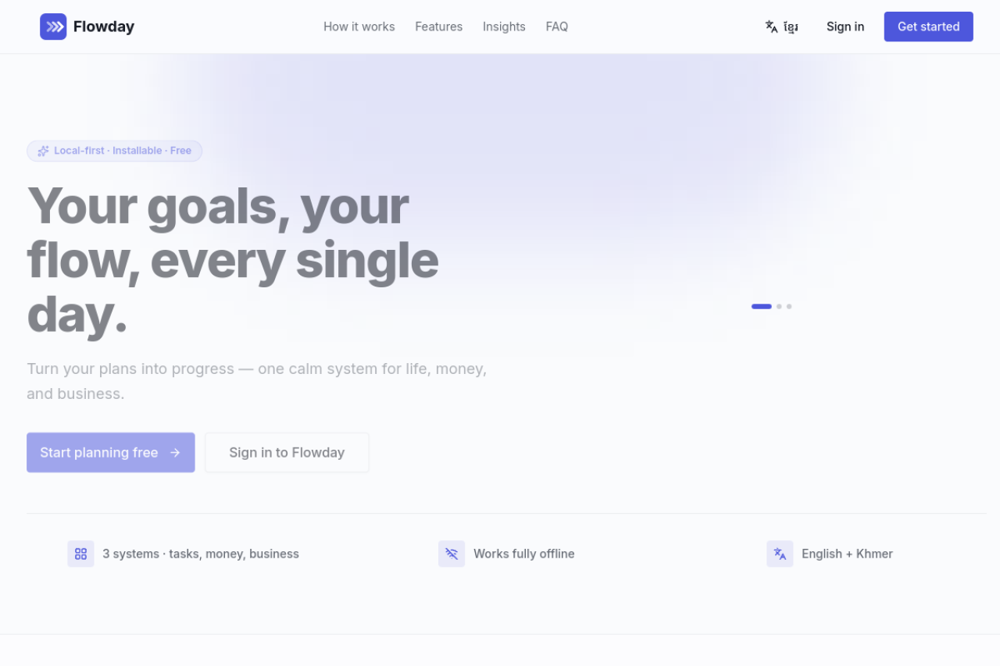
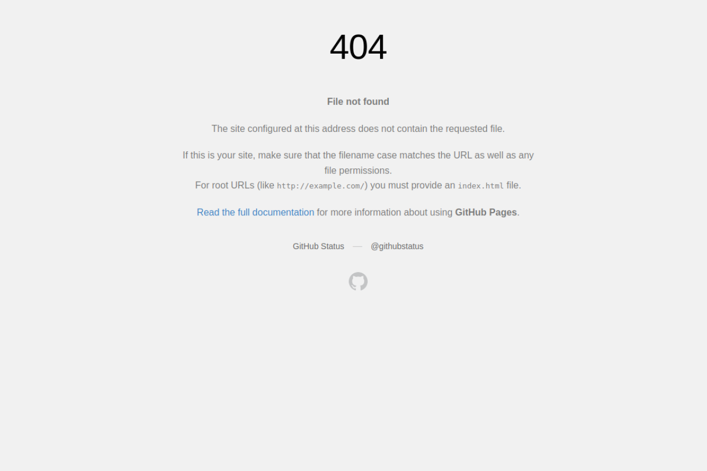
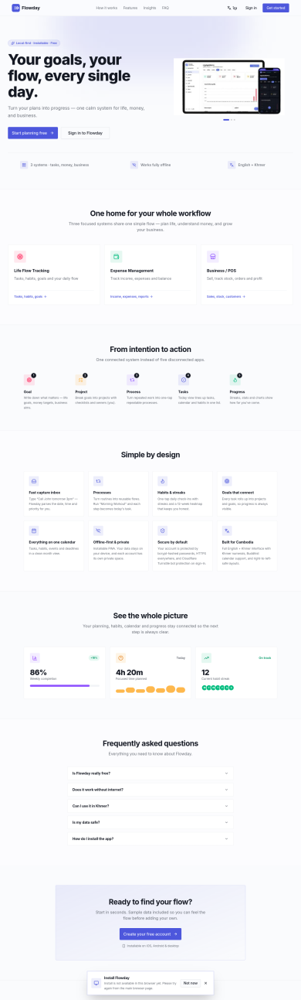

# Flowday — Personal Workflow & Tasks

A mobile-first personal workflow & task management PWA: Goals → Projects → Processes → Tasks → Daily Actions → Progress.

**Stack:** React 19 · TypeScript · Vite · Tailwind CSS 4 · shadcn/ui · Framer Motion · Neon Postgres (serverless Postgres over HTTPS — works from a static site)

## Screenshots

<p align="center">
  
</p>

<p align="center">
  
  &nbsp;&nbsp;
  
</p>

Live site: [kamazore.github.io/my-life-flow](https://kamazore.github.io/my-life-flow/)

## Architecture

- **Frontend:** static Vite SPA — deployable to GitHub Pages, Netlify, or any static host.
- **Backend:** Neon Postgres, accessed directly from the browser via `@neondatabase/serverless` (HTTP driver). No server to run or pay for.
  - `users` — accounts (email + bcrypt password hash)
  - `app_data` — one JSON document per user (tasks, projects, processes, habits, goals, notes, calendar)
- **Local-first:** every change saves to `localStorage` instantly and syncs to Neon in the background (debounced). Offline changes stay on the device and push when back online. The app also works fully offline-signed-in thanks to the service worker.
- **Routing:** hash-based (`/#/today`) so it works on static hosting without server rewrites.

## Environment

| Variable | Where to set it | Purpose |
| --- | --- | --- |
| `VITE_NEON_DATABASE_URL` | Freebuff editor → Keys/API keys (or a local `.env.local` when developing) | Neon Postgres connection string (`postgresql://…neon.tech/db?sslmode=require`) |

Get the connection string from [console.neon.tech](https://console.neon.tech) → your project → **Connection string**. Tables are created automatically on first use.

> Note: the connection string ships with the app bundle, so it is readable by anyone using the site. Use a dedicated Neon project/role for this app, and don't reuse a connection string that has other privileges.

## Local development

```bash
bun install
bun run dev        # start dev server
bun tsc -b --noEmit # typecheck
bun run build:pages # production build for GitHub Pages (relative asset base)
```

## Deploy to GitHub Pages

1. Push this repo to GitHub.
2. Repo → **Settings → Pages → Build and deployment → Source: GitHub Actions**.
3. Push to `main` (or run the "Deploy to GitHub Pages" workflow manually). `.github/workflows/deploy.yml` builds and publishes automatically.
4. Add the `VITE_NEON_DATABASE_URL` build-time value if you build outside the Freebuff editor — on GitHub Actions, add it as a repo variable/secret and inject it into the build step, e.g.:
   ```yaml
   - name: Build
     env:
       VITE_NEON_DATABASE_URL: ${{ secrets.VITE_NEON_DATABASE_URL }}
     run: bun run build:pages
   ```

## PWA

- Manifest + service worker are subpath-safe, so the installable PWA works at `username.github.io/repo/`.
- Offline: the app shell is cached; data changes queue locally and sync when online.
